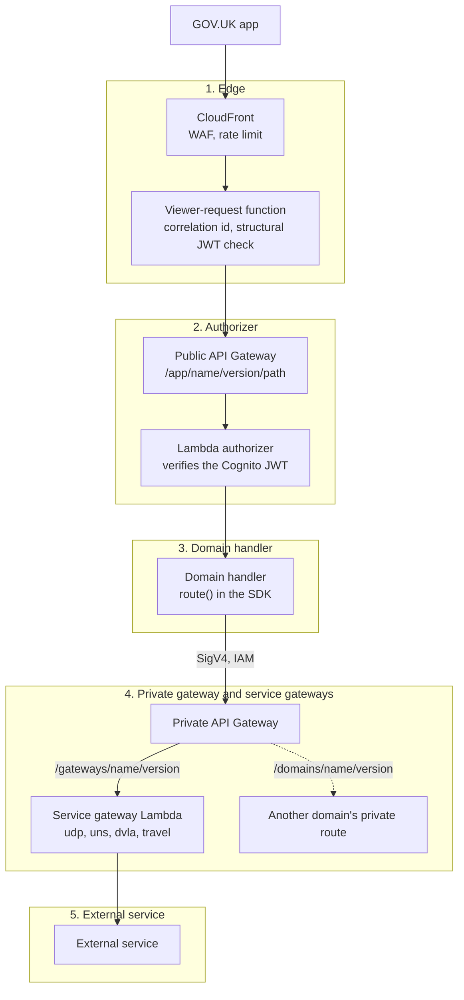
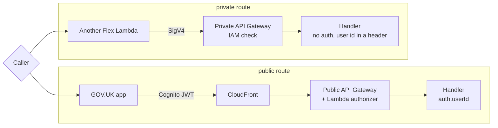
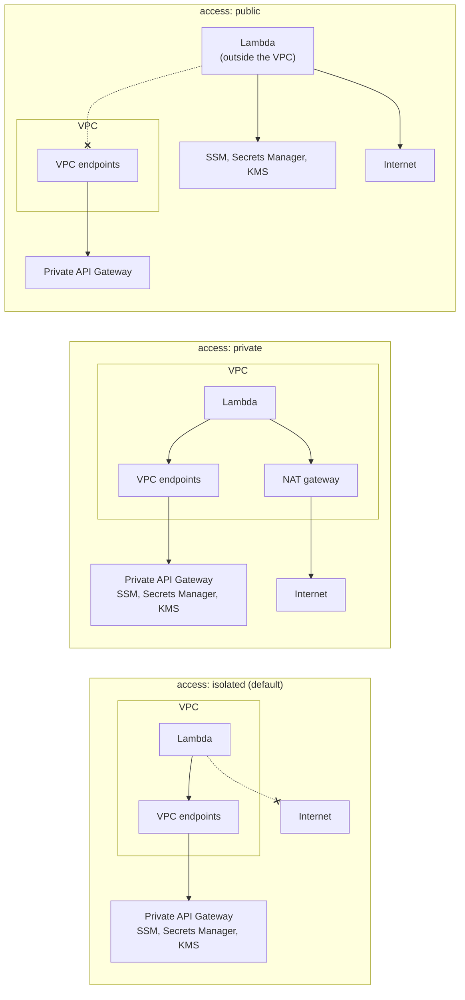

## A request from the app

This page follows a request from the GOV.UK app to an external service and back. The app calls a domain's **public** route. Each step names the code that does the work.

Flex Lambdas also call each other's **private** routes, which skip the app's path. See [Inbound: `public` and `private` routes](#inbound-public-and-private-routes).

### 1. Edge

Requests reach **CloudFront**, which has a WAF in front of it:

- AWS managed rule sets, to block common attacks and known bad inputs and IPs.
- A rate limit per IP address.
- A bypass rule for E2E tests, which match on the `x-flex-e2e-bypass` header. See [Testing](/flex/domains/testing/).

The rules are defined in [`global.ts`](https://github.com/govuk-once/flex/blob/main/platform/infra/flex/src/stacks/global.ts). In `staging` and `production`, the distribution is also protected by AWS Shield Advanced.

Caching is disabled. CloudFront forwards to the API Gateway with a secret `x-origin-verify` header, and a second WAF on the API rejects requests without it. Nothing can reach the API except through CloudFront.

The **viewer-request function** ([`viewer-request-cff-platform`](https://github.com/govuk-once/flex/tree/main/platform/domains/viewer-request-cff-platform)) runs on every request before it goes to the API:

- It keeps an incoming `x-correlation-id` if it is a valid UUID v4. Otherwise it derives one from the CloudFront request id.
- It checks the `Authorization` header is `Bearer <token>` and that the token is shaped like a JWT: three segments, a JSON header and body, and not `alg: none`.
- It does **not** verify the signature. A malformed token gets a `401` with the header `x-rejected-by: cloudfront-function`.

### 2. Authorizer

Domains with public routes have a Lambda authorizer on the `Authorization` header ([`platform/domains/auth`](https://github.com/govuk-once/flex/tree/main/platform/domains/auth)). It does the real verification:

- It checks the signature against the Cognito JWKS, and checks the token is an access token for the expected client.
- It takes the `username` claim as the **pairwise id**: a pseudonymous id for the user. It returns this to API Gateway as `pairwiseId` in the authorizer context.
- If anything is wrong it returns a deny, and the gateway responds `401`.

In personal stages, `pr-<n>` stages and `development`, the JWKS comes from a stub endpoint, so stub tokens from `pnpm jwt` are accepted. See [Environment setup](/flex/getting-started/environment-setup/). `staging` and `production` use the real Cognito JWKS.

### 3. Domain handler

Public routes are served at `/app/<domain>/<version>/<path>`. Each route is its own Lambda, built with the `route()` factory from the domain's `domain.config.ts`. The SDK builds the handler context:

- `auth.userId` is the authorizer's `pairwiseId`, parsed into the branded `UserId` type. This is what handlers use. The request is rejected if it is missing.
- Body, query and headers are validated against the Zod schemas in the config. A bad request gets a `400`, and a response that doesn't match its schema gets a `500`.
- Resources, integrations and feature flags declared on the route are injected.

### 4. Private gateway and service gateways

A domain calls anything outside itself through an **integration**:

- **Service gateways** (`/gateways/<name>/<version>`) wrap an external API in a Flex contract. They exist for `udp`, `uns`, `dvla` and `travel`, in [`platform/domains/`](https://github.com/govuk-once/flex/tree/main/platform/domains).
- **Other domains** are called on their private routes (`/domains/<name>/<version>`).

Both go through the **private API Gateway**, which uses IAM authorisation and is reachable only through a VPC endpoint. The SDK signs the call with SigV4, and IAM permissions are granted for exactly the routes the integration declares.

Private routes have no authorizer and no `auth`, so they carry no user identity of their own. The caller passes the user id in a header that the route declares, such as `requesting-service-user-id`.

### 5. External service

The service gateway Lambda authenticates to the external service, calls it and maps the response to the Flex contract. The response then travels back along the same path.

A new external partner needs a new gateway. That is platform work. See [Current limits](/flex/introduction/current-limits/).

## Inbound routes and outbound access

The steps above follow one path. Two route settings change which path applies, and they answer different questions. See [Who can call a route, and what it can call](/flex/domains/overview/#who-can-call-a-route-and-what-it-can-call) for the detail.

### Inbound: `public` and `private` routes

This decides who can call a route, and what identity the handler gets. The request above is the public path.

### Outbound: `access`

This decides where a route's Lambda runs, and so what it can call. It has nothing to do with who can call the route. "Internet" here means anything outside AWS.

Almost every domain uses `isolated`. A domain reaches external services through a service gateway rather than calling them itself.
